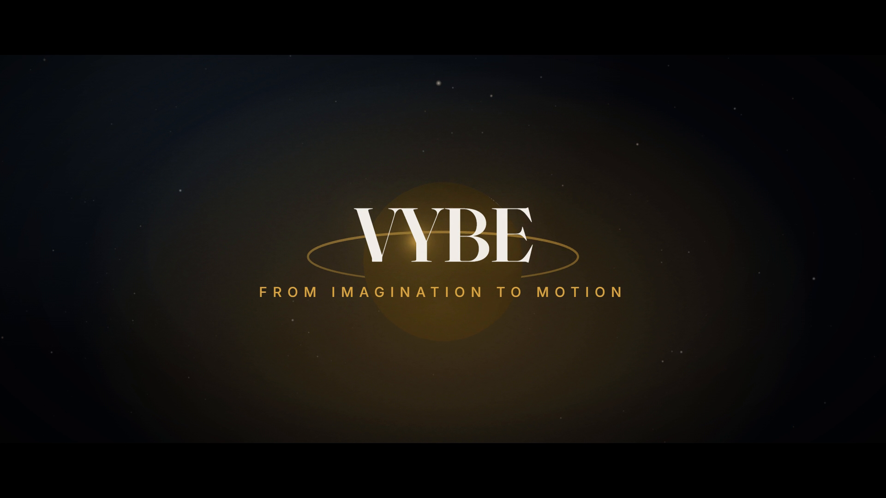

<div align="center">

# VYBE

### From imagination to motion.

**Autonomous Motion Graphics Agent Skill** · by **SJ BUILDS**

An autonomous AI motion graphics skill that turns natural-language prompts into cinematic,
animated and professionally rendered videos using HyperFrames and modern creative technologies.

`/vybe Create a cinematic 30-second video explaining black holes`

[Install](#installation) · [Usage](#usage) · [How it works](#how-it-works) · [Audio](#audio-providers) · [Image to motion](#image-to-motion) · [Troubleshooting](#troubleshooting)

</div>

---

## What VYBE does

[](examples/cinematic-teaser/exports/final.mp4)

<sub>Rendered by the VYBE pipeline in this repo — 10s, 1080p, Three.js + GSAP, local Kokoro narration,
Parakeet word-level captions, procedural score. Source, storyboard and QC report:
[`examples/cinematic-teaser`](examples/cinematic-teaser).</sub>

One prompt in, one finished video out. VYBE runs inside your AI coding agent and works like a
small motion studio: a creative director, a storyboard artist, a motion designer, a 3D artist,
a sound designer and a render engineer — each step written down, checked, and kept editable.

```text
prompt ─► brief ─► creative direction ─► storyboard ─► assets ─► HyperFrames composition
                                                                       │
        exports/final.mp4 ◄── finalize ◄── QC loop (frames + FFmpeg) ◄── render ◄── audio
```

- **Any kind of video** — cinematic teasers, product ads, explainers, social reels, logo reveals,
  documentary intros, kinetic typography, launch videos from your own codebase, animated photos.
- **Real motion design** — GSAP choreography, Three.js worlds and particles, SVG that draws itself,
  masks, depth, parallax, camera moves, designed transitions. Not a slideshow.
- **Sound** — voiceover (HeyGen, ElevenLabs, Gemini, or free local Kokoro), music (HeyGen catalog,
  Google Lyria, MusicGen, or VYBE's offline procedural score), sound effects on the action,
  ducking, loudness-normalized delivery, word-synced captions.
- **It checks its own work** — HyperFrames lint/runtime/layout/contrast gates before rendering,
  FFmpeg measurements after (duration, black frames, freezes, loudness, clipping), frame
  extraction for vision review, and a bounded fix-and-re-render loop with a written report.
- **Free by default** — every stage has a local path. Paid APIs are optional upgrades.
- **Honest** — never claims a render, a generation or a check that didn't happen.

## Supported agents

| Agent | Discovery | Install |
| --- | --- | --- |
| **Claude Code** | `.claude/skills/` (project) · `~/.claude/skills/` (user) · plugin marketplace | Skills CLI or `/plugin` |
| **OpenAI Codex CLI** | `.agents/skills/` · `~/.agents/skills/` | Skills CLI |
| **Cursor** | `.agents/skills/` · `~/.cursor/skills/` | Skills CLI |
| **OpenCode** | `.agents/skills/` · `~/.config/opencode/skills/` | Skills CLI |
| Other [Agent Skills](https://agentskills.io) clients | `skills/<name>/SKILL.md` | Skills CLI or copy the folder |

The core instructions are agent-independent. Claude Code exposes the skill as the `/vybe`
command; in other agents, ask for "vybe" or describe the video ("use the vybe skill to…").

## Requirements

- **Node.js 22+** and **FFmpeg** (with `ffprobe`) on your `PATH`
- **HyperFrames CLI** — used through `npx hyperframes` (no global install needed);
  it downloads its headless Chrome on first use
- Recommended: the official HyperFrames agent skills (`npx skills add heygen-com/hyperframes`) —
  VYBE uses them as the authority on the composition contract when present
- Optional: `npx hyperframes models install parakeet` for accurate local word-level captions

Check everything with:

```bash
node skills/vybe/scripts/vybe.mjs doctor
```

## Installation


**Any agent, via the [Skills CLI](https://github.com/vercel-labs/skills):**

```bash
# everything (recommended: the orchestrator + 7 specialists)
npx skills add SJbuilds04/VYBE --skill '*'

# or just the orchestrator (works alone; specialists add depth)
npx skills add SJbuilds04/VYBE --skill vybe

# global install for one agent
npx skills add SJbuilds04/VYBE --skill '*' -g -a claude-code
```

**Claude Code plugin:**

```text
/plugin marketplace add SJbuilds04/VYBE
/plugin install vybe@vybe
```

**From a clone (development, or agents without a skills CLI):**

```bash
git clone https://github.com/SJbuilds04/VYBE.git && cd VYBE
npm run link        # repairs .claude/skills and .agents/skills links (junctions on Windows)
npm run validate    # structural checks against the Agent Skills spec
```

Then open your agent in the cloned folder, or copy `skills/*` into your agent's skills directory.

## Usage

```text
/vybe Create a cinematic 30-second video explaining black holes
/vybe Create an Apple-style advertisement for an iPhone --format vertical
/vybe Make a futuristic 3D animation explaining artificial intelligence --voice
/vybe Generate a 20-second Instagram reel about robotics
/vybe Create an animated logo reveal for "Nova"
/vybe Create a kinetic typography music video --style "risograph zine"
/vybe Turn my project into a product launch video --project ./my-website
/vybe Animate this image cinematically --image ./photo.jpg
/vybe Make the clouds move and the camera slowly zoom in --image ./landscape.jpg
/vybe Make a cinematic technology documentary intro --review
```

### Flags

| Flag | Values | Default |
| --- | --- | --- |
| `--format` | `landscape` · `vertical` · `square` · `landscape-4k` · `vertical-4k` · `square-4k` | landscape (reels: vertical; inferred from the prompt) |
| `--duration` | seconds | from the prompt, else per template (8–40s) |
| `--style` | `apple-minimal` · `cinematic` · `cyberpunk` · `scientific` · `kinetic-typography` · `corporate` · `experimental` · or any description | creative director's choice |
| `--template` | `cinematic` · `product-ad` · `explainer` · `social-reel` · `logo-reveal` · `documentary` · `kinetic-typography` | inferred |
| `--voice [provider]` | `heygen` · `elevenlabs` · `kokoro` · `gemini` | off (on if you ask for narration) |
| `--no-music` · `--no-sfx` · `--no-captions` | flags | music on, SFX on, captions with narration |
| `--review` | approve direction + storyboard before building | autonomous |
| `--quality` | `draft` · `standard` · `high` | high |
| `--fps` | 24 · 25 · 30 · 50 · 60 | 30 |
| `--project <path>` | a codebase to promote | — |
| `--image <path>` | image(s) to animate or feature | — |
| `--motion` · `--provider` | `auto` · `programmatic` · `ai` / image-to-video provider | auto |
| `--max-fixes` | QC fix budget (0–10) | 3 |
| `--social` | also write share copy | off |

Flags combine freely, and plain language works too: *"a 20-second vertical reel with narration"*.

**Review mode** (`--review`) stops after the creative direction and storyboard and waits for your
approval. Without it, VYBE runs end to end and records every assumption in `brief.md`.

## How it works

| Stage | What happens | Artifact |
| --- | --- | --- |
| 0 Preflight | detects tools, HyperFrames skills, and which providers are configured (presence only) | `vybe doctor` |
| 1 Interpret | parses flags + prose into a brief; scaffolds an isolated project from a template | `brief.md`, `vybe.json` |
| 2 Direct | one concept, a visual system (palette, type, motion language, camera, transitions, sound) | `creative-direction.md` |
| 3 Storyboard | scene-by-scene plan; validated for timing, readability, narration fit and monotony | `storyboard.json` / `.md` |
| 4 Assets | procedural first; your media; licensed or generated media with credits | `composition/assets/`, `credits.md` |
| 5 Compose | HyperFrames sub-composition per scene (HTML, CSS, SVG, GSAP, Three.js) | `composition/` |
| 6 Audio | voice → music → SFX → captions, normalized, ducked and wired into the composition | `audio/audio-manifest.json` |
| 7 Render | `hyperframes check` gate, then `hyperframes render` | `renders/render-NN.mp4` |
| 8 QC | FFmpeg measurements + frames for vision review → fix → re-render (bounded) | `quality-report.md`, `previews/qc-NN/` |
| 9 Deliver | −14 LUFS delivery mix, thumbnail, SRT captions, manifest | `exports/` |

The deterministic steps live in a zero-dependency Node engine (`skills/vybe/scripts/vybe.mjs`);
taste lives in the skill instructions. Every command prints JSON and fails loudly.

### Output

```text
vybe-output/<project>/
├── brief.md · creative-direction.md · storyboard.md · composition-brief.md · quality-report.md · share-copy.md
├── composition/          editable HyperFrames project (index.html + compositions/ + assets/)
├── audio/ · previews/ · renders/ · sources/
└── exports/  final.mp4 · thumbnail.png · captions.srt · manifest.json
```

Edit any result afterwards with `cd composition && npx hyperframes preview` (HyperFrames Studio).

## Architecture

```text
skills/
├── vybe/                       the orchestrator  (/vybe)
│   ├── SKILL.md                pipeline, rules, routing (loads references on demand)
│   ├── references/             workflow · invocation · creative-direction · style-engine · storyboard ·
│   │                           assets · composition-guide · audio-pipeline · video-formats ·
│   │                           quality-control · output-structure · project-to-video
│   ├── scripts/vybe.mjs        engine: doctor · parse · init · storyboard · audio · music · render · qc · finalize
│   └── assets/                 7 templates · 7 style presets · 6 OFL fonts
├── vybe-motion-design/         principles, transitions, camera, effects
├── vybe-cinematic-3d/          deterministic Three.js, particles, lighting
├── vybe-typography/            type systems, kinetic type, captions
├── vybe-audio-design/          music direction, SFX spotting, voice, mix
├── vybe-visual-storytelling/   hooks, arcs, pacing, composition
├── vybe-video-quality/         QC loop, defect taxonomy, rendering
└── vybe-image-to-motion/       image analysis, 2.5D layers/depth, AI image-to-video providers
.claude/skills/* · .agents/skills/*   → symlinks to skills/* (agent discovery)
.claude-plugin/                      Claude Code plugin + marketplace manifests
```

Specialists are loaded only when a storyboard needs them, keeping context small. Each skill is
installable on its own; the orchestrator degrades gracefully when a specialist is missing.

### Templates

| Template | Highlights |
| --- | --- |
| `cinematic` | Three.js dust field and lit orb, camera arc across three acts, letterbox, grain, flare wipe |
| `product-ad` | persistent 3D hero device across scenes, feature cascade, count-up proof, CTA end card |
| `explainer` | self-drawing SVG diagram with callouts, 3D card process, progress rail |
| `social-reel` | vertical-first, hook at frame 0, directional card wipes, stat + bars, safe zones |
| `logo-reveal` | seeded shard convergence, shockwave ring, per-glyph wordmark, bloom |
| `documentary` | Ken Burns plates, archival grain, quote card, animated timeline, title card |
| `kinetic-typography` | one word per beat, color-field flips, type-as-camera, center-out mask reveal |

All seven pass `npx hyperframes check` in landscape, and use container units so the same
composition works in 16:9, 9:16 and 1:1.

## Audio providers

| Layer | Order (auto) | Free path |
| --- | --- | --- |
| Voiceover | HeyGen → ElevenLabs → Kokoro-82M | **Kokoro** (local, via `npx hyperframes tts`) |
| Music | HeyGen catalog → Google Lyria → MusicGen → VYBE procedural | **VYBE procedural score** (FFmpeg synthesis, always available) |
| SFX | HeyGen library → HyperFrames bundled library → VYBE synth | **bundled library** (19 Pixabay-licensed files) |
| Captions | HeyGen word timestamps → Parakeet → whisper.cpp | **Parakeet** (`npx hyperframes models install parakeet`) |

Choose explicitly with `--voice heygen|elevenlabs|kokoro|gemini`. An explicitly chosen provider
never silently falls back. Credentials are read from the environment and never written to output:

| Provider | Environment |
| --- | --- |
| HeyGen | `heygen auth login --oauth` (free allowance) or `HEYGEN_API_KEY` |
| ElevenLabs | `ELEVENLABS_API_KEY` |
| Google (Gemini TTS, Lyria, Omni Flash video) | `GEMINI_API_KEY` or `GOOGLE_API_KEY` |
| Runway (Gen-4.5, Veo 3.1, Kling 3.0) | `RUNWAYML_API_SECRET` |
| Luma (Ray 3.2) | `LUMA_AGENTS_API_KEY` |
| Kling direct (experimental) | `KLING_ACCESS_KEY` + `KLING_SECRET_KEY` |

When no transcription engine is available, captions fall back to line-level timing and say so —
VYBE never invents word timings. Music and SFX licenses are recorded in `audio/audio-manifest.json`.

## Image to motion

```text
/vybe Make this product rotate with cinematic lighting --image ./product.png
/vybe Make the person appear to walk forward --image ./portrait.jpg --motion ai --provider runway
```

VYBE analyzes the image, plans the motion and chooses the technique:

- **Programmatic** (free, identity-preserving): subject cut-out with HyperFrames' local background
  removal, a hole-filled background plate, depth-scaled parallax, camera moves, fog, particles and
  light — or a Three.js depth-map shader for true 2.5D parallax.
- **AI image-to-video** for organic motion (people walking, faces, water, hair, transformations):
  Runway (Gen-4.5, Veo 3.1, Kling 3.0), Luma Ray 3.2, Gemini Omni Flash, Kling direct (experimental).
  Submission, polling, download, provenance and error handling included; `--dry-run` shows the
  request with keys redacted.

If a request needs AI motion and no provider is configured, VYBE delivers the programmatic version
and says clearly that realistic subject motion was **not** generated.

## Configuration

- **Styles**: `skills/vybe/assets/styles/styles.json` — tokens, motion, camera, transitions, sound per preset.
- **Templates**: `skills/vybe/assets/templates/<name>/` — host `index.html` + `compositions/*.html`.
- **Fix budget**: `--max-fixes`, stored per project in `vybe.json`.
- **Output location**: `--out <dir>` on `vybe init` (default `./vybe-output`).

## Testing

```bash
npm run validate          # Agent Skills spec + discovery links + manifests + templates + secret scan
npm test                  # unit tests (parser, storyboard, scaffolding, audio wiring, QC parsers, providers with mocked HTTP)
npm run test:integration  # real tools: template lint/check, procedural audio, QC on synthetic video, end-to-end render
```

Paid-provider tests are opt-in and never need the maintainer's credentials
(`VYBE_LIVE_PROVIDER_TESTS=1` with your own keys). See [`tests/README.md`](tests/README.md)
for what each test proves and the benchmark scenarios.

## Troubleshooting

| Problem | Fix |
| --- | --- |
| `vybe doctor` reports a blocker | install Node 22+ / FFmpeg; check network for `npx hyperframes` |
| Render is very slow or crashes | low RAM: VYBE adds `--low-memory-mode` under 1.5 GB free; also try `--workers 1`, close apps, render `--quality draft` first |
| Black 3D layer | WebGL unavailable in the render browser — see `vybe-cinematic-3d` performance notes |
| Captions are line-level, not word-level | `npx hyperframes models install parakeet` |
| No music provider | the procedural score is used; sign in to HeyGen or set `GEMINI_API_KEY` for richer music |
| Skills not found in Codex/Cursor/OpenCode | reinstall with `npx skills add … -a <agent>`; in a clone run `npm run link` |
| Symlinks became text files on Windows | `npm run link` (creates junctions; no admin needed) |
| `hyperframes check` fails | read its findings — they name the file and the fix; see `vybe-video-quality` |

## Contributing

Contributions are welcome — new templates, style presets, provider adapters, QC checks.
See [CONTRIBUTING.md](CONTRIBUTING.md).

## License

[MIT](LICENSE) © 2026 SJ BUILDS — covers VYBE's own files. Bundled fonts are under the SIL Open
Font License 1.1 (`skills/vybe/assets/fonts/OFL.txt`).

## Credits

VYBE is built on, and does not claim ownership of, these projects — see [CREDITS.md](CREDITS.md):
[HyperFrames](https://hyperframes.heygen.com) (HeyGen) · [GSAP](https://gsap.com) ·
[Three.js](https://threejs.org) · [FFmpeg](https://ffmpeg.org) · Kokoro-82M · Parakeet ·
whisper.cpp · Inter, Space Grotesk, Fraunces, JetBrains Mono, Anton, Orbitron (OFL) ·
the [Agent Skills](https://agentskills.io) specification · the
[Skills CLI](https://github.com/vercel-labs/skills). Architecture inspired by publicly available
skill projects such as BRAG; VYBE is an independent, original implementation.

<div align="center">

**VYBE** — From imagination to motion. · Made by **SJ BUILDS**

</div>
